# P-Data building blocks

How the P-Data building blocks depend on each other. The red **periodic ETL** box is what `edi_pipeline` is building: retrieve publications from Infoscience (IS) and OpenAlex (OA), merge them, merge the authors, and loop until the sets of author IDs are stable, then load the result into OpenSearch. Today the package covers the retrieve steps (`fetch/`); merging and indexing come next.

Colours: blue = data source · green = bibliometrics tool · yellow = algorithm · purple = application · red = periodic ETL.

Mermaid source

The picture above is generated from this source. It needs Mermaid's ELK layout, so it may look jumbled where ELK is not available.

```mermaid
---
title: P-Data building blocks
config:
  look: classic
  layout: elk
  elk:
    forceNodeModelOrder: true
    considerModelOrder: NODES_AND_EDGES
  theme: neutral
  themeCSS: ".flowchart-link.edge-pattern-solid:not(.edge-pattern-dotted) { stroke-width: 2.2px !important; }"
  flowchart:
    curve: basis
    nodeSpacing: 40
    rankSpacing: 70
---
flowchart TB

  %% Declaration order = left-to-right placement (ELK forceNodeModelOrder):
  %% LabExplorer column · sources · ETL → OpenSearch · world bibliometrics → bibliometric DWH

  %% ───────────── LabExplorer column ─────────────
  ALIRA{{"ALIRA<br/><small>active-learning retrieval</small>"}}
  LE(["LabExplorer<br/><small>which labs work on a topic?</small>"])

  %% ───────────── Data sources ─────────────
  subgraph SRC["Data sources"]
    direction LR
    ORCID[("ORCID integration<br/><small>verified SCIPER ↔ ORCID</small>")]
    INFO[("IS (Infoscience)<br/><small>EPFL publications, curated</small>")]
    OA[("OA (OpenAlex)<br/><small>the world's works</small>")]
  end

  %% ───────────── EPFL publications flow (weekly) ─────────────

  subgraph ETL["periodic ETL"]
    direction LR
    E1["Retrieve pubs from IS"]
    subgraph LOOP["Loop until the sets of IDs are stable"]
      direction LR
      E1B["Retrieve pubs from OA"]
      E2{{"Merge Pubs (Gaël)"}}
      CONS@{ shape: doc, label: "Consolidated list<br/>of publications" }
      DTM{{"Merge Authors (Aitor)"}}
      MAP@{ shape: doc, label: "Sets of IDs (min 1 from IS)" }
      STABLE{"Stable?"}
    end
    %% note declared before FINAL so it sits to its left (see the invisible MAP ~~~ NOTE6 link)
    NOTE6@{ shape: card, label: "We don't infer<br/>the researchers' lab:<br/>we record the labs<br/>attached to a paper from IS" }
    FINAL@{ shape: doc, label: "Final consolidated list<br/>of publications<br/>and sets of IDs" }
    E1 --> E2
    E1B --> E2
    E2 --> CONS
    CONS --> DTM
    DTM --> MAP
    MAP --> STABLE
    STABLE -- "no: next round<br/>with the authors" --> E1B
    STABLE -- "yes" --> FINAL
    %% invisible: makes ELK start the loop at "Retrieve pubs from OA", so only the "no" edge points back up
    E1B ~~~ STABLE
  end

  subgraph SILOS["other EPFL data"]
    direction LR
    NEWS[("EPFL news")]
    GRANTS[("Grants")]
    COMP[("Company<br/>descriptions")]
    MORE[("…")]
  end
  OS[("OpenSearch ✱<br/><small>BI unit · see note</small>")]

  %% ───────────── World bibliometrics flow ─────────────
  OAM["OAM<br/><small>scores for every in-scope work</small>"]
  ZEN[("Zenodo<br/><small>OAM scores, open to everyone</small>")]
  OAR["OAR<br/><small>detailed records related to EPFL</small>"]
  IMAP["Institutional mapping<br/><small>e.g. all publications of a faculty (ENAC)</small>"]
  BWH[("Bibliometric DWH<br/><small>data source for Brad's analyses</small>")]

  %% ───────────── Links ─────────────
  %% (edges inside subgraphs come first: 0 E1→E2, 1 E1B→E2, 2 E2→CONS, 3 CONS→DTM, 4 DTM→MAP, 5 MAP→STABLE, 6 STABLE→E1B (loop back), 7 STABLE→FINAL, 8 E1B~~~STABLE;
  %%  then 9 INFO→E1, 10 ORCID→DTM, 11 OA→E1B 1st round, 12 OA→E1B next rounds, …)
  INFO -- "all pubs (#lt;10yrs)" --> E1
  ORCID -- "known pairs" --> DTM
  OA -- "1st round (#lt;10yrs)<br/>pubs <b>affiliated to EPFL</b>" --> E1B
  OA -- "next rounds (#lt;10yrs)<br/>pubs <b>by author</b>" --> E1B
  FINAL --> OS
  SILOS --> OS

  OS --> LE
  ALIRA --> LE

  OA -- "snapshot" --> OAM
  OAM -- "release" --> ZEN
  ZEN -- "scores" --> OAR
  OA -- "API" --> OAR
  OAR --> IMAP
  OS -- "flat view" --> IMAP
  IMAP --> BWH
  %% invisible, kept last so linkStyle indices above do not shift: puts the note at the bottom left of the ETL box, below the loop
  MAP ~~~ NOTE6

  %% ───────────── Styling ─────────────
  classDef source  fill:#e6eef8,stroke:#3b6ea5,color:#1d3550
  classDef inhouse fill:#e8f3e6,stroke:#4a8a3f,color:#1f3d1a
  classDef algo    fill:#fdf3d8,stroke:#b08a1e,color:#4a3a08
  classDef app     fill:#efe6f6,stroke:#7a4fa0,color:#36204a
  classDef step    fill:#ffffff,stroke:#c0392b,color:#222
  classDef algoout fill:#fffaf0,stroke:#b08a1e,color:#4a3a08
  classDef postit  fill:#fff3a8,stroke:#d4b106,color:#5a4a00,font-size:12px

  class INFO,ORCID,OA,BWH,OS,ZEN,NEWS,GRANTS,COMP,MORE source
  class OAM,OAR,IMAP inhouse
  class DTM,ALIRA,E2 algo
  class MAP,CONS,FINAL algoout
  class LE app
  class E1,E1B,STABLE step
  class NOTE6 postit

  style ETL fill:#fff5f3,stroke:#c0392b,stroke-width:3px,color:#c0392b
  style LOOP fill:none,stroke:#c0392b,stroke-width:1.5px,stroke-dasharray:6 4,color:#c0392b
  linkStyle 6 stroke:#c0392b
  %% next-rounds OA query: red dashed like the loop, so it reads as part of it
  linkStyle 12 stroke:#c0392b,stroke-dasharray:8 5
  style SRC fill:none,stroke:#9fb3c8,stroke-dasharray:6 4
  style SILOS fill:none,stroke:#9fb3c8,stroke-width:1.5px
```

